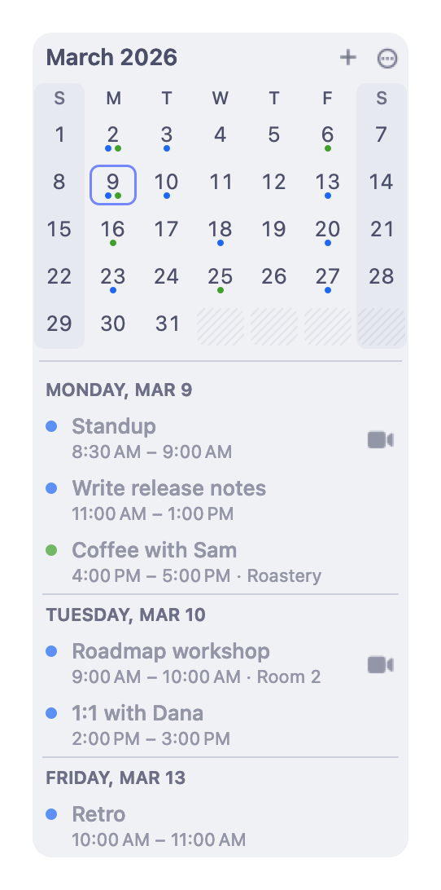
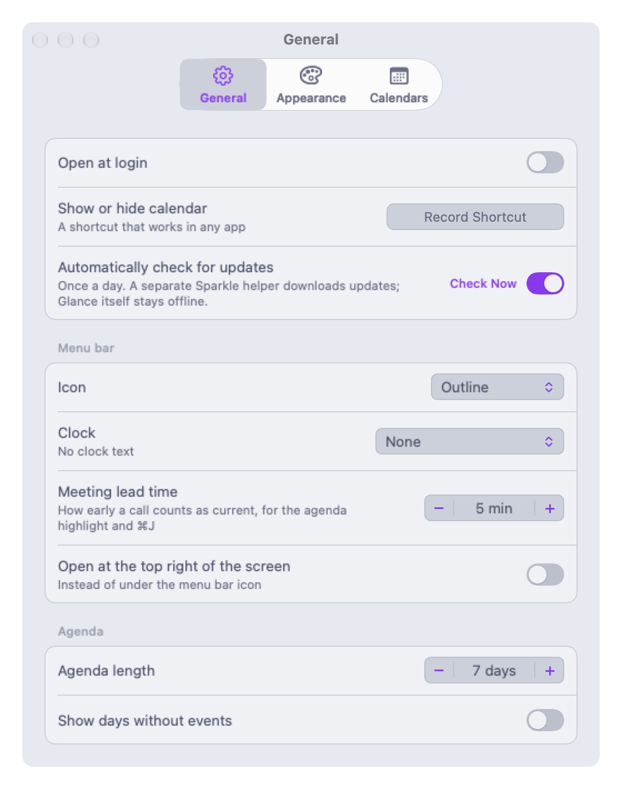
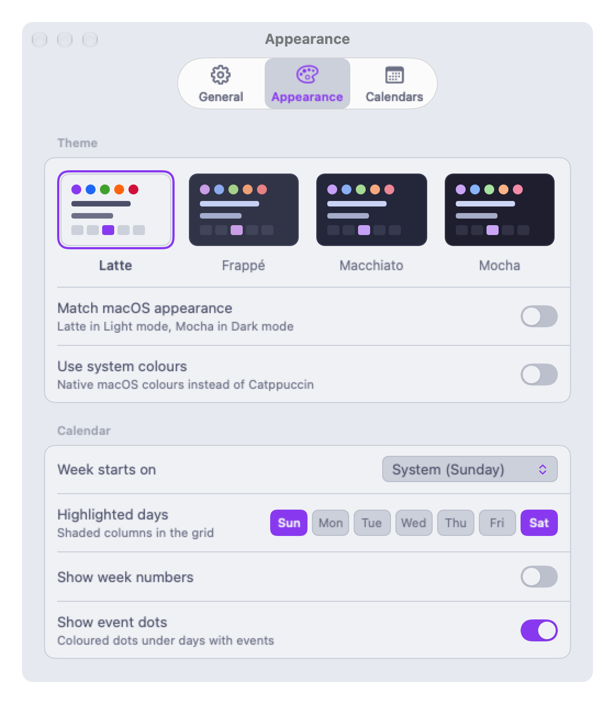
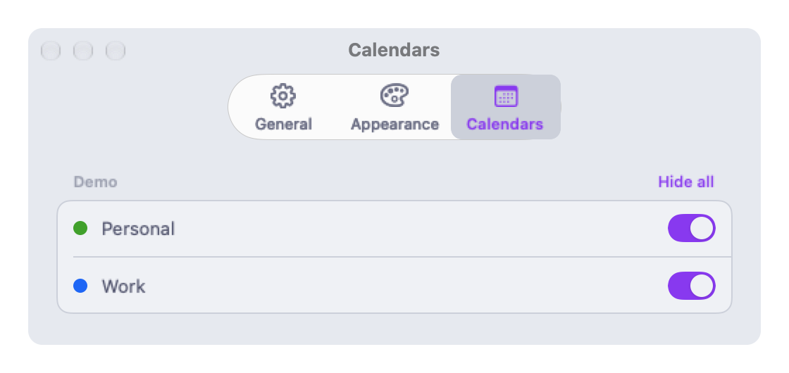
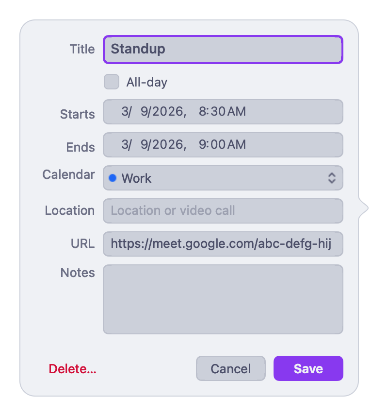

# Glance

<picture>
  <source media="(prefers-color-scheme: dark)" srcset="docs/popover-mocha.png">
  
</picture>

A small native macOS menu bar calendar: today's date in the menu bar, a
month grid and agenda under it, Catppuccin themes, meeting join links and
event editing. Swift 6 (strict concurrency) and AppKit, EventKit for data.
The only third-party code is [Sparkle](https://sparkle-project.org) for
updates.

Requires **macOS 27** or later. There is no build for older releases; the
app is built against the macOS 27 SDK and uses APIs from it.

Website: **[glancecalendar.app](https://glancecalendar.app)**

[](https://buymeacoffee.com/stevefrost)

## Screenshots

Both themes are shown: GitHub picks the one matching your light or dark
setting.

| | |
|---|---|
| <picture><source media="(prefers-color-scheme: dark)" srcset="docs/settings-general-mocha.png"></picture> | <picture><source media="(prefers-color-scheme: dark)" srcset="docs/settings-appearance-mocha.png"></picture> |
| <picture><source media="(prefers-color-scheme: dark)" srcset="docs/settings-calendars-mocha.png"></picture> | <picture><source media="(prefers-color-scheme: dark)" srcset="docs/editor-mocha.png"></picture> |

These are drawn by the app itself, not captured from a screen — see
[Building](#building). The calendars in them are invented.

## Install

Download the latest `Glance-<version>.zip` from
[Releases](https://github.com/steveafrost/Glance/releases/latest), unzip it
and move `Glance.app` to Applications. It's signed with Developer ID and
notarized. On first launch Glance opens under its menu bar icon and macOS asks
for calendar access.

## Privacy

Glance reads your calendars through macOS (EventKit) and nothing else. There
are no accounts and no sign-ins, and the app has no network access at all:
it's sandboxed without the outgoing-connections entitlement. Updates are
fetched by Sparkle's separate Downloader service, which only downloads the
update feed and update archives from this repository's GitHub Releases. It
sends nothing about you or your calendars (system profiling is off).
`script/check-offline.sh` and `OfflineGuardTests` fail the build if this
ever changes.

Updates are checked once a day; turn that off in Settings › General, or use
Check for Updates… in the ⋯ menu or the icon's right-click menu.

## Features

- **Menu bar date icon** drawn as a template image and placed in menu bar
  coordinates, so the box is centred on macOS 27's 30pt bar (rows 7–22)
  instead of sitting a point high. Outline or filled style.
- **Clock text** next to the icon from any Unicode date pattern
  (`EEE h:mm a`, `HH:mm:ss`…). The item keeps a fixed width so nothing
  jitters; the icon can be hidden.
- **Month grid + agenda** in a popover-style window under the item. Handles
  multiple displays, auto-hiding and full-screen menu bars, and falls back
  to the screen's top-right corner when the item is hidden.
- **Themes**: Catppuccin Latte, Frappé, Macchiato, Mocha, Catppuccin
  auto (Latte/Mocha) and System light/dark.
- **Meetings**: Zoom, Google Meet, Teams, Webex (and a few others) are found
  in an event's location, URL or notes. The agenda gets a join button
  (opening the native app when installed) and highlights the call that is
  current or about to start. ⌘J joins it.
- **Events**: create, edit and delete (with confirmation and a this/future
  prompt for repeating events). Declined events are hidden.
- **Calendars**: choose which appear, grouped by account.
- **Week numbers**, highlighted weekdays and first day of week.
- **Global hotkey** (Carbon, recorded in Settings) and **Open at login**.

## Navigating the calendar

- Two-finger swipe left or right over the grid: next or previous month
  (follows your fingers whether or not natural scrolling is on).
- ← / → : previous or next month. ↑ / ↓ : previous or next year.
- ⇧-arrows or h / j / k / l : move the selected day.
- Space or t : jump to today.
- Return : new event on the selected day. Double-click a day does the same.
- Esc : close. ⌘, : Settings. ⌘J : join the current meeting. w : week numbers.

## Building

Needs Xcode 27 (the scripts use `DEVELOPER_DIR`, so `xcode-select` can point
anywhere).

```sh
script/test.sh                 # swift test
script/build-app.sh            # build/Glance.app
script/build-app.sh --install  # replace /Applications/Glance.app and launch it
script/docs-shots.sh           # every docs screenshot, both themes
```

The screenshots in this README are rendered by the app itself:
`--qa-keys dump-popover`, `dump-settings` and `dump-editor` draw each window
into a bitmap instead of reading the screen, and `--qa-demo-data` swaps
EventKit for an invented calendar, so no personal data is involved and the
command works on a Mac with no calendar account. The flags are QA-only and
inert unless passed. `script/docs-shots.sh` drives all of them in Mocha and
Latte and writes the ten PNGs in `docs/`.

`build-app.sh` signs with the first "Apple Development" identity in the
keychain (override with `GLANCE_SIGN_IDENTITY`, or `-` for ad-hoc). A stable
identity keeps the Calendar permission across rebuilds. The app is sandboxed
with the calendars entitlement and the hardened runtime. It embeds
`Sparkle.framework` (with its XPC services) in `Contents/Frameworks` and signs
inside-out. Dev builds get a placeholder feed (`*.invalid`), so they never
check for updates; `GLANCE_FEED_URL=… script/build-app.sh` overrides it.
`script/check-offline.sh [Glance.app]` runs the offline guard.

## Releasing

A release has three stages. Each can run on a different Mac; the
`dist/Glance-<version>/` folder carries everything between them.

| Stage | Needs | Does |
|---|---|---|
| `script/release.sh build 1.2.0` | this repo, Xcode 27, the Developer ID Application certificate | Release build (Developer ID, hardened runtime, secure timestamp, inside-out), offline check, zip with `ditto`, `manifest.env`, draft release notes, a copy of `notarize.sh` |
| `dist/Glance-1.2.0/notarize.sh` | only the dist folder, Xcode or the Command Line Tools, a `notarytool` keychain profile | `notarytool submit --wait`, staple, `stapler validate` and `spctl` check, zip again |
| `script/release.sh publish 1.2.0` | this repo, the Sparkle EdDSA key in the keychain, `gh` signed in | `generate_appcast` on the stapled zip (keeping older versions from the previous appcast), EdDSA check, GitHub release `v1.2.0` with the zip and `appcast.xml` |

Edit `dist/Glance-1.2.0/Glance-1.2.0.md` (the release notes; they're
embedded in the appcast and used as the GitHub release body) before
publishing. The build stage needs a clean tree: the release is tagged at the
commit it was built from.

**Moving the dist folder between Macs.** Use `ditto`, which keeps the
signatures, symlinks and extended attributes:

```sh
ditto -c -k --keepParent dist/Glance-1.2.0 Glance-1.2.0-dist.zip   # on the build Mac
# copy it over (AirDrop, scp, a shared drive), then on the notary Mac:
ditto -x -k Glance-1.2.0-dist.zip . && Glance-1.2.0/notarize.sh
# and back again; unpack into dist/ in this repo before publishing.
```

**Notary profile (once per Mac).** `notarize.sh` uses the keychain profile in
`$GLANCE_NOTARY_PROFILE` (default `glance`) and prints this command if it's
missing:

```sh
xcrun notarytool store-credentials glance --apple-id "<Apple ID email>" --team-id 4QJ25Y85MX
```

It asks for an app-specific password from account.apple.com.

**EdDSA key.** Updates are signed with a Sparkle EdDSA key kept in the login
keychain of the publishing Mac (the public half is `SUPublicEDKey` in
`Resources/Info.plist`). It's never committed. Back it up somewhere safe,
like a password manager, and restore it on another Mac:

```sh
.build/artifacts/sparkle/Sparkle/bin/generate_keys -x glance-sparkle-key.txt   # export
.build/artifacts/sparkle/Sparkle/bin/generate_keys -f glance-sparkle-key.txt   # import
rm glance-sparkle-key.txt
```

Losing it means existing installs can't verify new updates. (The tools
appear after `swift package resolve`.)

**Feed.** `SUFeedURL` is
`https://github.com/steveafrost/Glance/releases/latest/download/appcast.xml`:
GitHub redirects it to the `appcast.xml` asset of the newest release. That
keeps the appcast next to the archives it lists, with no commit per release,
and it changes the moment the release is published. A raw file on `main`
would need a commit for every release and is cached by the CDN for a few
minutes. The cost is that drafts and pre-releases never become "latest", so
a beta channel would need its own feed.

### Layout

- `Sources/GlanceCore` — pure, tested logic: day/week math, month grid,
  per-month event cache, meeting-link parser, clock format, icon geometry,
  popover placement, swipe tracking, agenda rows, event drafts, palettes.
- `Sources/Glance` — the AppKit app. The grid is one layer-backed view that
  draws every cell; the agenda is a view-based table with reused cells;
  EventKit lives on an actor and hands back Sendable snapshots.
- `script/measure-menubar.swift` — measures glyph rows in a menu bar
  screenshot (`screencapture -x -R<x>,0,<w>,30 bar.png`).

### Debug flags

`open /Applications/Glance.app --args <flags>`: `--show` opens the calendar
at launch, `--keep-open` stops it hiding on focus loss, `--print-geometry`
logs the status button geometry (`log show --predicate 'subsystem ==
"com.steveafrost.Glance"'`), `--reference-symbol` adds an SF Symbol item for
alignment checks, `--qa-keys "right,shift+down,return,swipe-left"`
feeds input through the real handlers. Any preference can be overridden for
one run, e.g. `-theme mocha -clockFormat "EEE h:mm a"`.

`script/measure-grid.sh OUT LABEL THEME KEYS [prefs]` measures how far each
day's event dots sit from the centre of its number's ink, in points, from a
screenshot and from offscreen 1x and 2x renders (the `dump-grid` QA key), e.g.
`script/measure-grid.sh /tmp/m dec latte right -highlightedWeekdays 0`.

## Credits

Glance is a from-scratch rewrite whose behaviour is modelled on
[Itsycal](https://www.mowglii.com/itsycal/) by Sanjay Madan (MIT), via
Steve's Catppuccin fork. No Itsycal code is included; see [LICENSE](LICENSE).
Colours are from the [Catppuccin](https://catppuccin.com) palette (MIT).

## Support

Glance is free and MIT-licensed, with no subscription and no pro tier. If it
earns a place in your menu bar, you can
[buy me a coffee](https://buymeacoffee.com/stevefrost).
