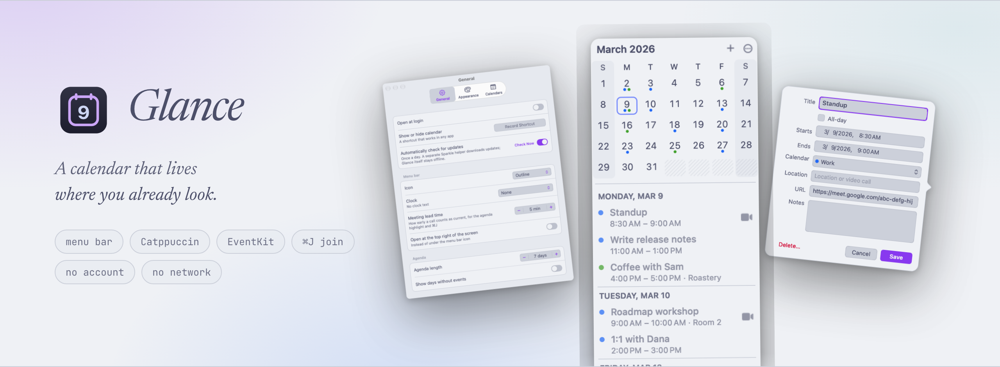

# Glance

<picture>
  <source media="(prefers-color-scheme: dark)" srcset="docs/banner-mocha.png">
  
</picture>

A small native macOS menu bar calendar: today's date in the menu bar, a
month grid and agenda under it, Catppuccin themes, meeting join links and
event editing. Swift 6 (strict concurrency) and AppKit, EventKit for data,
no third-party code at all.

Glance is **$0.99 on the Mac App Store**. Requires **macOS 26** or later —
the current release and the one before it. There is no build for older
releases.

Website: **[glancecal.com](https://glancecal.com)**

[](https://buymeacoffee.com/stevefrost)

## Screenshots

Both themes are shown: GitHub picks the one matching your light or dark
setting.

| | |
|---|---|
| <picture><source media="(prefers-color-scheme: dark)" srcset="docs/settings-general-mocha.png"></picture> | <picture><source media="(prefers-color-scheme: dark)" srcset="docs/settings-appearance-mocha.png"></picture> |
| <picture><source media="(prefers-color-scheme: dark)" srcset="docs/settings-calendars-mocha.png"></picture> | <picture><source media="(prefers-color-scheme: dark)" srcset="docs/editor-mocha.png"></picture> |

These are drawn by the app itself, not captured from a screen — see
[Building](#building). The calendars in them are invented.

## Install

From the Mac App Store. On first launch Glance opens under its menu bar icon
and macOS asks for calendar access.

This repository is the source. It is not the distribution channel: the App
Store build is the only supported binary, and the store delivers updates.

## Privacy

Glance reads your calendars through macOS (EventKit) and nothing else. There
are no accounts and no sign-ins, and the app has no network access at all:
it's sandboxed without the outgoing-connections entitlement, and there is no
updater in the app at all — the store delivers updates. There is no code path
that could send your events, your habits or anything else off the Mac.
`script/check-offline.sh` and `OfflineGuardTests` fail the build if this ever
changes, including if an updater is added back.

## Features

- **Menu bar date icon** drawn as a template image and placed in real menu bar
  coordinates, so the box is centred in the bar instead of sitting a point
  high. Outline or filled style.
- **Clock text** next to the icon from any Unicode date pattern
  (`EEE h:mm a`, `HH:mm:ss`…). The item keeps a fixed width so nothing
  jitters; the icon can be hidden.
- **Month grid + agenda** in a popover-style window under the item. Handles
  multiple displays, auto-hiding and full-screen menu bars, and falls back
  to the screen's top-right corner when the item is hidden.
- **Themes**: Catppuccin Latte, Frappé, Macchiato, Mocha, Catppuccin
  auto (Latte/Mocha) and System light/dark.
- **Meetings**: Zoom, Google Meet, Teams, Webex (and a few others) are found
  in an event's location, URL or notes. The agenda gets a join button
  (opening the native app when installed) and highlights the call that is
  current or about to start. ⌘J joins it.
- **Events**: create, edit and delete (with confirmation and a this/future
  prompt for repeating events). Declined events are hidden.
- **Calendars**: choose which appear, grouped by account.
- **Week numbers**, highlighted weekdays and first day of week.
- **Global hotkey** (Carbon, recorded in Settings) and **Open at login**.

## Navigating the calendar

- Two-finger swipe left or right over the grid: next or previous month
  (follows your fingers whether or not natural scrolling is on).
- ← / → : previous or next month. ↑ / ↓ : previous or next year.
- ⇧-arrows or h / j / k / l : move the selected day.
- Space or t : jump to today.
- Return : new event on the selected day. Double-click a day does the same.
- Esc : close. ⌘, : Settings. ⌘J : join the current meeting. w : week numbers.

## Building

Needs Xcode 27 (the scripts use `DEVELOPER_DIR`, so `xcode-select` can point
anywhere).

```sh
script/test.sh                 # swift test
script/build-app.sh            # build/Glance.app
script/build-app.sh --install  # replace /Applications/Glance.app and launch it
script/docs-shots.sh           # every docs screenshot, both themes
```

The screenshots in this README are rendered by the app itself:
`--qa-keys dump-popover`, `dump-settings` and `dump-editor` draw each window
into a bitmap instead of reading the screen, and `--qa-demo-data` swaps
EventKit for an invented calendar, so no personal data is involved and the
command works on a Mac with no calendar account. The flags are QA-only and
inert unless passed. `script/docs-shots.sh` drives all of them in Mocha and
Latte and writes the ten PNGs in `docs/`.

`build-app.sh` signs with the first "Apple Development" identity in the
keychain (override with `GLANCE_SIGN_IDENTITY`, or `-` for ad-hoc). A stable
identity keeps the Calendar permission across rebuilds. The app is sandboxed
with the calendars entitlement and the hardened runtime, and there is nothing
to embed beyond the app's own code. `script/check-offline.sh [Glance.app]`
runs the offline guard.

## Releasing

Two steps, both described by files in `script/`.

| Step | Needs | Does |
|---|---|---|
| `script/mas-build.sh` | this repo, Xcode 27, `xcodegen`, an Apple Distribution certificate and the "Glance Mac App Store" profile | Generates `Glance.xcodeproj` from `project.yml`, archives, refuses a build with a network entitlement or `get-task-allow`, then packages `build/mas/Glance.pkg` signed with the installer certificate |
| `script/mas-build.sh --upload` | also an App Store Connect app record and the API key | `altool --validate-app`, then upload |

Then set the version's text and screenshots in App Store Connect, attach the
build, and submit. `script/release.sh tag 1.2.0` tags the commit the build came
from, so a store version maps to a sha; `script/release.sh notes 1.2.0` prints
the notes file from `dist/`.

There is no notarization step and no appcast: the App Store signs, hosts and
updates the app. `notarize.sh`, `generate_appcast` and the EdDSA key are gone
with the direct download they existed for.

### One-time store setup

All of this is in the developer portal and App Store Connect, done once:

- **App ID** `com.steveafrost.Glance`. Calendar access is an entitlement, not
  a portal capability, so there is nothing to tick.
- **Mac App Store provisioning profile** named `Glance Mac App Store`, made of
  that App ID and the Apple Distribution certificate.
- **Certificates**: the existing Apple Distribution identity signs the app; a
  `3rd Party Mac Developer Installer` identity signs the `.pkg`. The installer
  certificate's key must be in the login keychain of whatever Mac packages the
  build.
- **App record** in App Store Connect. The API refuses to create this one
  (`apps` allows only GET and UPDATE), so it has to be made in the web UI.
- **Paid Apps agreement** active, or a $0.99 tier cannot be selected.

### Layout

- `Sources/GlanceCore` — pure, tested logic: day/week math, month grid,
  per-month event cache, meeting-link parser, clock format, icon geometry,
  popover placement, swipe tracking, agenda rows, event drafts, palettes.
- `Sources/Glance` — the AppKit app. The grid is one layer-backed view that
  draws every cell; the agenda is a view-based table with reused cells;
  EventKit lives on an actor and hands back Sendable snapshots.
- `script/measure-menubar.swift` — measures glyph rows in a menu bar
  screenshot (`screencapture -x -R<x>,0,<w>,30 bar.png`).

### Debug flags

`open /Applications/Glance.app --args <flags>`: `--show` opens the calendar
at launch, `--keep-open` stops it hiding on focus loss, `--print-geometry`
logs the status button geometry (`log show --predicate 'subsystem ==
"com.steveafrost.Glance"'`), `--reference-symbol` adds an SF Symbol item for
alignment checks, `--qa-keys "right,shift+down,return,swipe-left"`
feeds input through the real handlers. Any preference can be overridden for
one run, e.g. `-theme mocha -clockFormat "EEE h:mm a"`.

`script/measure-grid.sh OUT LABEL THEME KEYS [prefs]` measures how far each
day's event dots sit from the centre of its number's ink, in points, from a
screenshot and from offscreen 1x and 2x renders (the `dump-grid` QA key), e.g.
`script/measure-grid.sh /tmp/m dec latte right -highlightedWeekdays 0`.

## Credits

Glance is a from-scratch rewrite whose behaviour is modelled on
[Itsycal](https://www.mowglii.com/itsycal/) by Sanjay Madan (MIT), via
Steve's Catppuccin fork. No Itsycal code is included; see [LICENSE](LICENSE).
Colours are from the [Catppuccin](https://catppuccin.com) palette (MIT).

## Support

Glance is free and MIT-licensed, with no subscription and no pro tier. If it
earns a place in your menu bar, you can
[buy me a coffee](https://buymeacoffee.com/stevefrost).
